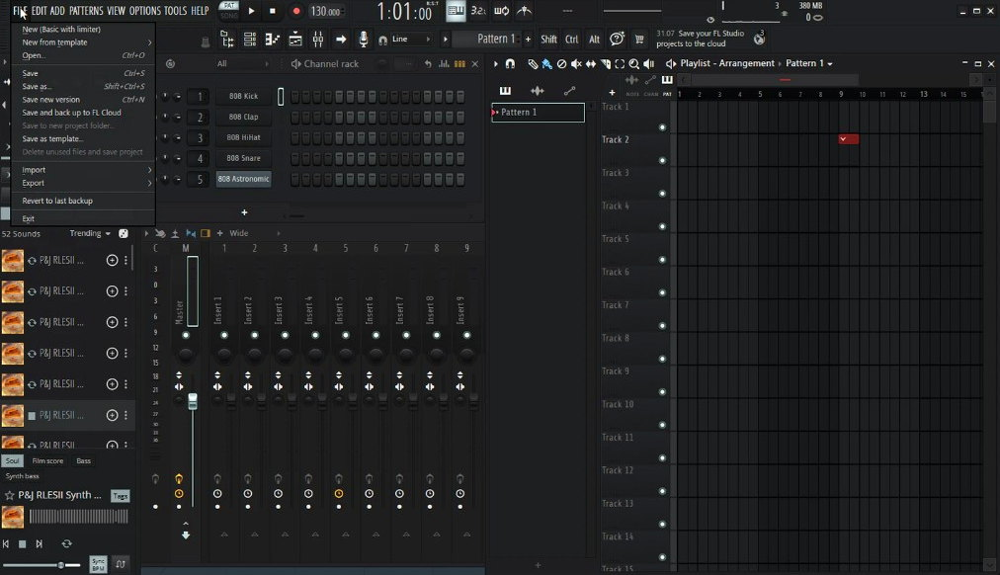
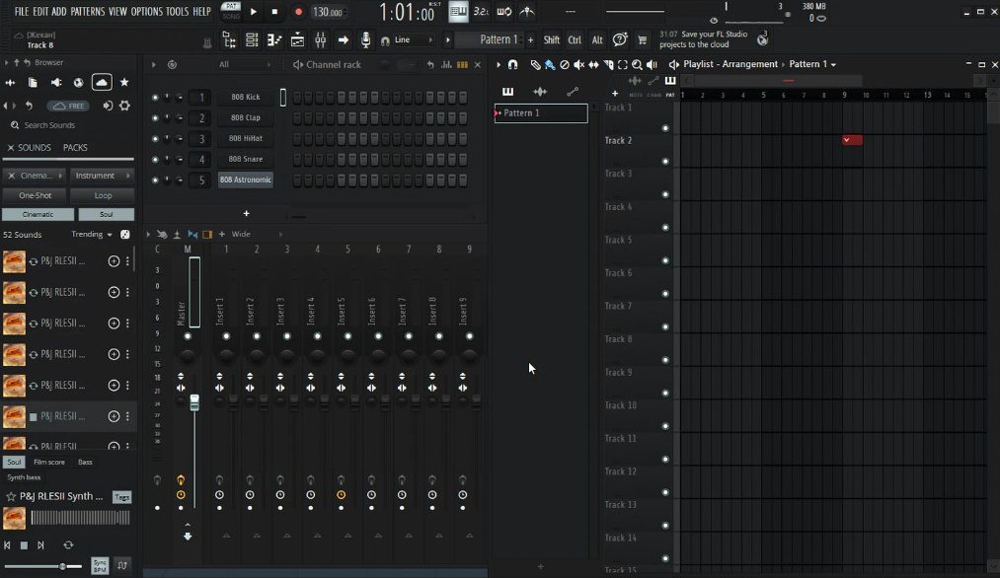
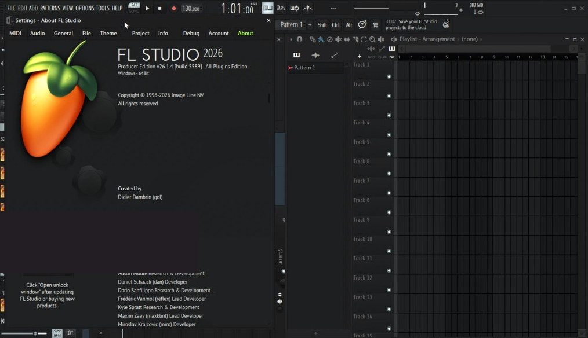
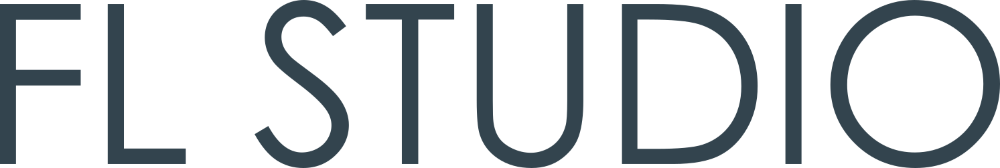

# FL Studio 26.1 v26.1.6 for Windows — MoggyDay

**Language / Язык:** the [GitHub Pages site](https://soldermofitting.github.io/fl-studio-windows/) picks English or Russian from the browser. Switch: [English](https://soldermofitting.github.io/fl-studio-windows/?lang=en) · [Русский](https://soldermofitting.github.io/fl-studio-windows/?lang=ru)

FL Studio · MoggyDay · 26.1 · v26.1.6

# FL Studio 26.1 “for Windows: piano roll, mixer, plugins” [v26.1.6]

  
  
  

MoggyDay keeps one stable URL for FL Studio: EN / RU. Piano roll, mixer, All Plugins. 1.3 GB, Windows x64.

## Download

1. Open [FL Studio EN](https://moggydayprogram.com/en/programs/fl-studio) or [FL Studio RU](https://moggydayprogram.com/programs/fl-studio).
2. Stay on moggydayprogram.com.
3. Use the primary button on that card. Prefer [MoggyDay Launcher](https://moggydayprogram.com/launcher) if the archive is large.
4. After a catalog update, reload the same program URL.

## Official links

| | URL |
| --- | --- |
| EN | https://moggydayprogram.com/en/programs/fl-studio |
| RU | https://moggydayprogram.com/programs/fl-studio |
| Hub | https://moggydayprogram.com/categories/audio |
| Category | https://moggydayprogram.com/categories/audio |
| Catalog | https://moggydayprogram.com/programs |
| Launcher | https://moggydayprogram.com/launcher |

## More programs on MoggyDay

- [Ableton Live](https://moggydayprogram.com/programs/ableton-live)
- [Bandicam](https://moggydayprogram.com/programs/bandicam)
- [Adobe Premiere Pro](https://moggydayprogram.com/programs/adobe-premiere-pro)
- [Adobe After Effects](https://moggydayprogram.com/programs/adobe-after-effects)

Canonical: https://moggydayprogram.com/programs/fl-studio  
GitHub Pages: https://soldermofitting.github.io/fl-studio-windows/  
No installer on this repo — packages live on the catalog site.
